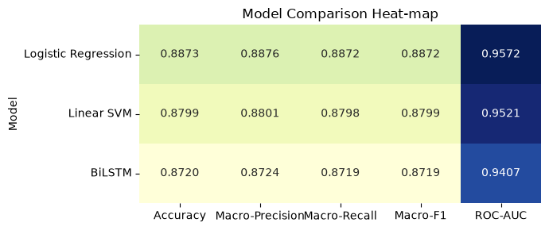
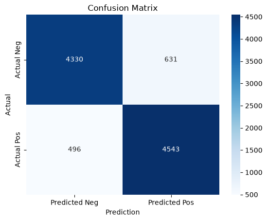
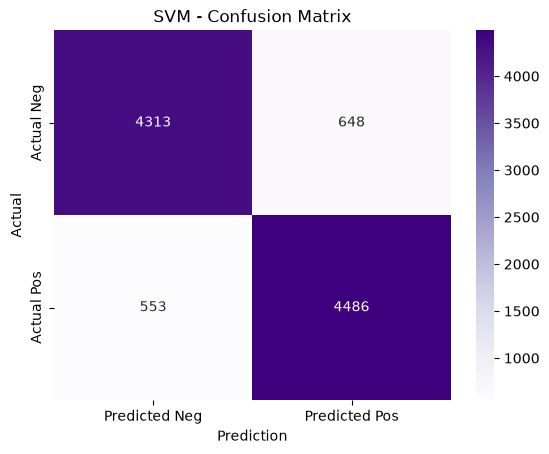
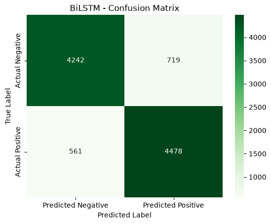

# IMDB Movie Review Sentiment Classification

Binary sentiment classification of 50,000 IMDB movie reviews, comparing TF-IDF Logistic Regression and Linear SVM with a bidirectional LSTM.

## Highlights

- Three classifiers on the same 80/20 split: TF-IDF + Logistic Regression, TF-IDF + Linear SVM, and a Keras BiLSTM
- Best model: **Logistic Regression** with 0.8873 accuracy, 0.8872 macro-F1 and 0.9572 ROC-AUC on a 10,000-review test set
- Text pipeline: HTML removal, normalization, NLTK stopword filtering, then TF-IDF (5,000 terms) or Keras tokenization (10,000-word vocabulary)
- Leakage-free setup: the data is split first, and the TF-IDF vectorizer and tokenizer are fit on the training reviews only
- Evaluation with five metrics (accuracy, macro precision / recall / F1, ROC-AUC), confusion matrices and comparison charts

## Overview

The task is to predict whether a movie review is positive or negative from its raw text. The project compares two classic linear text classifiers on sparse TF-IDF features against a recurrent neural network that reads the review as a word sequence. The goal is to see how much a sequence model adds over linear baselines on this benchmark.

## Dataset

[IMDB Dataset of 50K Movie Reviews](https://www.kaggle.com/datasets/lakshmi25npathi/imdb-dataset-of-50k-movie-reviews) (Kaggle), a CSV version of the Stanford [Large Movie Review Dataset](https://ai.stanford.edu/~amaas/data/sentiment/) by Maas et al. (2011).

- 50,000 reviews with a `review` text column and a `sentiment` label
- Perfectly balanced: 25,000 positive and 25,000 negative
- Review length (words, before cleaning): average 231.16, median 173, range 4 to 2,470

The dataset is not included in this repository. See the source pages for terms of use, and cite Maas et al. (2011) if you use it.

## Approach

**Preprocessing.** Lowercasing, HTML tag removal, removal of all non-letter characters, whitespace normalization and English stopword removal (NLTK).

**Train / test split.** One 80/20 split (`random_state=42`) shared by all models, made before any features are fitted. The TF-IDF vectorizer and the Keras tokenizer are fit on the training reviews only and then applied to the test reviews, so no test-set information leaks into the features.

**Models.**

| Model | Input representation | Configuration |
|---|---|---|
| Logistic Regression | TF-IDF, 5,000 features | `max_iter=1000` |
| Linear SVM | TF-IDF, 5,000 features | `LinearSVC`, default settings |
| BiLSTM | Token sequences, 10,000-word vocabulary, length 300 | Embedding (64) → BiLSTM (64) → Dropout (0.5) → Dense (64, ReLU) → Dense (1, sigmoid); Adam, binary cross-entropy, 5 epochs, batch size 128, 20% validation split |

**Evaluation.** Accuracy, macro-averaged precision, recall and F1, and ROC-AUC on the 10,000-review test set. ROC-AUC uses predicted probabilities for Logistic Regression and the BiLSTM, and decision-function scores for the Linear SVM.

## Results

| Model | Accuracy | Macro-Precision | Macro-Recall | Macro-F1 | ROC-AUC |
|---|---|---|---|---|---|
| Logistic Regression | **0.8873** | **0.8876** | **0.8872** | **0.8872** | **0.9572** |
| Linear SVM | 0.8799 | 0.8801 | 0.8798 | 0.8799 | 0.9521 |
| BiLSTM | 0.8720 | 0.8724 | 0.8719 | 0.8719 | 0.9407 |

In the BiLSTM training log, validation loss was lowest after the first epoch (0.2879) and rose to 0.4030 by epoch 5, while training accuracy reached 0.9600. The network starts to overfit within the five training epochs.



*Test-set metrics for all three models: Logistic Regression leads on every metric.*

| Logistic Regression | Linear SVM | BiLSTM |
|---|---|---|
|  |  |  |

*Confusion matrices on the 10,000-review test set (rows: actual class, columns: predicted class).*

## Key findings

- TF-IDF features capture most of the sentiment signal in these reviews. Logistic Regression achieved the best score on all five metrics, closely followed by Linear SVM.
- The small gap between the two linear models suggests that the sentiment classes are largely linearly separable in TF-IDF space, so additional model complexity did not pay off on this dataset.
- Macro-precision and macro-recall are nearly identical for every model, so none of them shows a significant bias toward one class.
- The BiLSTM did not beat the linear baselines but still reached a ROC-AUC of 0.9407, showing the potential of sequence models for capturing context in text.

## Tech stack

Python 3.12, pandas, NumPy, NLTK, scikit-learn, TensorFlow / Keras, Matplotlib, seaborn. Runs locally or on Google Colab.

## Project structure

```
imdb-sentiment-classification/
├── imdb_sentiment_classification.ipynb   # EDA, preprocessing, models, evaluation, discussion
├── figures/                              # plots used in this README
├── requirements.txt
└── README.md
```

## How to run

1. Download `IMDB Dataset.csv` from [Kaggle](https://www.kaggle.com/datasets/lakshmi25npathi/imdb-dataset-of-50k-movie-reviews).
2. **Locally:** place the file at `data/IMDB Dataset.csv` and run:
   ```bash
   pip install -r requirements.txt jupyter
   jupyter notebook imdb_sentiment_classification.ipynb
   ```
   The NLTK stopword list is downloaded automatically on first run. The full notebook takes a few minutes on CPU.
3. **Google Colab:** upload the CSV to the root of your Google Drive (`MyDrive/IMDB Dataset.csv`), open the notebook in Colab ([link](https://colab.research.google.com/github/efe-akpinar/imdb-sentiment-classification/blob/main/imdb_sentiment_classification.ipynb)) and run all cells. The notebook detects Colab and mounts Google Drive automatically.

The BiLSTM is not seeded, so its scores vary slightly between runs.

---

Built as a team project (team of 5). My part was the model evaluation and comparison: the metrics, confusion matrices and comparison charts.
